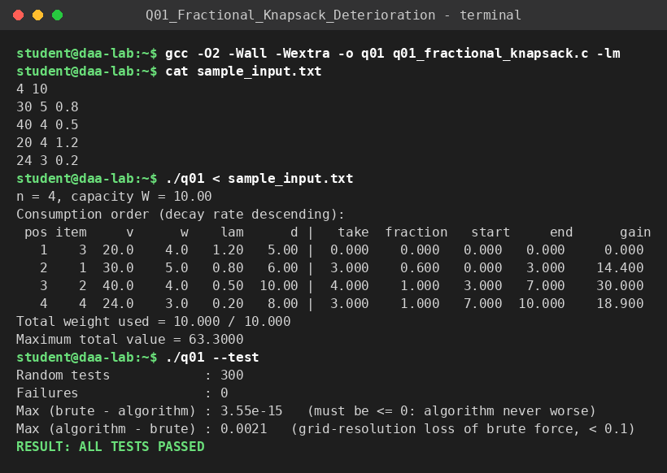

# Q1 – Fractional Knapsack with Deterioration Rate

**File:** `q01_fractional_knapsack.c`  |  **Paradigm:** greedy ordering + exact concave optimisation

## Problem
`n` items with base value `v_i`, weight `w_i`, decay rate `λ_i > 0`. An item consumed at time `t` has value density `(v_i/w_i) − λ_i·t`. Knapsack capacity is `W`. Choose the consumption order and fractions that maximise total value.

## How the statement is modelled (assumption – please check against your lecture notes)
Items are consumed one after another at **1 weight-unit per time-unit**, so the clock at any moment equals the total weight consumed so far. A unit of item `i` taken at time `t` is worth `d_i − λ_i·t` (`d_i = v_i/w_i`). Fractions are allowed and the decay applies continuously while an item is being consumed, so taking `x` units of item `i` starting at time `T` yields
`x·(d_i − λ_i·T) − λ_i·x²/2`.
If your instructor intends a different time model (for example, one clock tick per item), the order lemma below still gives a starting point, but the amount-selection step would change.

## Input representation
```
n  W
v_1 w_1 λ_1
...
v_n w_n λ_n
```
Arrays of `double`; items are stored in a struct `{id, v, w, λ, d}` so they can be sorted together.

## Algorithm
1. **Order lemma.** For fixed amounts, total value = `Σ x_i d_i − ∫ t·λ(t) dt`. The first term is order-independent; the second is minimised by pairing early times with large `λ` (rearrangement inequality). Swapping two adjacent blocks `i, j` changes the value by `(λ_i − λ_j)·(t₂ − t₁)`, independent of `d`. **So consume items in descending `λ`**, each as one contiguous block.
2. **Amounts.** With items sorted, let `P_j = x_1+…+x_j`, `δ_j = λ_j − λ_{j+1}`, `a_j = d_j − d_{j+1}` (with `λ_{n+1} = d_{n+1} = 0`). Abel summation gives
   `value = Σ_j [ a_j·P_j − δ_j·P_j²/2 ]`, a concave, separable function of the prefix sums, subject to `0 ≤ P_j − P_{j−1} ≤ w_j`, `P_n ≤ W`.
3. Solve the chain exactly: `F_j(p) = f_j(p) + max_{p−w_j ≤ q ≤ p} F_{j−1}(q)`. `F_{j−1}` is concave, so the sliding-window maximum keeps the part left of the arg-max `m`, inserts a flat piece of length `w_j` at `m`, and shifts the rest right by `w_j`. The derivative stays piecewise linear; adding `f_j'` adds a linear term. Back-track the stored arg-maxima to recover each `x_j`.

## Correctness
Step 1 is an exchange argument. Steps 2–3 solve a concave program exactly (no heuristics): the DP is the textbook recursion for a chain-constrained separable concave maximisation, and each operation on the derivative is the exact transformation of the function. The program also validates itself: 300 random instances are compared against a brute force that tries **every order** and amounts on a 0.1 grid; the algorithm must never be worse and may differ only by the grid's resolution loss.

## Complexity
* Sort by `λ`: `O(n log n)`.
* DP: stage `j` holds at most `2j+1` derivative pieces (each stage adds the split at `m` and one flat piece). Arg-max scan, copy/shift and linear update are each `O(j)`, so the total is `Σ_{j=1..n} O(j) = O(n²)`.
* Back-tracking `O(n)`. **Total `O(n²)` time, `O(n)` space.**

## Build & run
```bash
gcc -O2 -Wall -Wextra -o q01 q01_fractional_knapsack.c -lm
./q01 < sample_input.txt
./q01 --test
```

## Sample run
<!-- SAMPLE_RUN_START -->
```text
$ gcc -O2 -Wall -Wextra -o q01 q01_fractional_knapsack.c -lm
$ cat sample_input.txt
4 10
30 5 0.8
40 4 0.5
20 4 1.2
24 3 0.2
$ ./q01 < sample_input.txt
n = 4, capacity W = 10.00
Consumption order (decay rate descending):
 pos item     v      w    lam      d |   take  fraction   start     end      gain
   1    3  20.0    4.0   1.20   5.00 |  0.000    0.000   0.000   0.000     0.000
   2    1  30.0    5.0   0.80   6.00 |  3.000    0.600   0.000   3.000    14.400
   3    2  40.0    4.0   0.50  10.00 |  4.000    1.000   3.000   7.000    30.000
   4    4  24.0    3.0   0.20   8.00 |  3.000    1.000   7.000  10.000    18.900
Total weight used = 10.000 / 10.000
Maximum total value = 63.3000
$ ./q01 --test
Random tests            : 300
Failures                : 0
Max (brute - algorithm) : 3.55e-15   (must be <= 0: algorithm never worse)
Max (algorithm - brute) : 0.0021   (grid-resolution loss of brute force, < 0.1)
RESULT: ALL TESTS PASSED
```


<!-- SAMPLE_RUN_END -->
