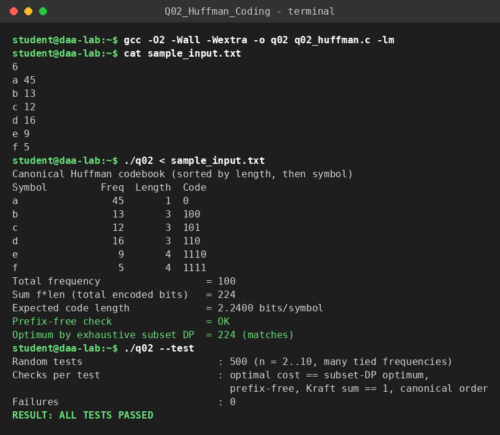

# Q2 – Huffman Coding (canonical codebook)

**File:** `q02_huffman.c`  |  **Paradigm:** greedy (min-heap merging)

## Problem
Given symbol frequencies, build a prefix-free binary code of minimum expected length and print the **canonical** codebook (codes ordered by length, then lexicographically by symbol).

## Input representation
```
n
symbol_1 freq_1
...
symbol_n freq_n
```
Symbols are space-free tokens (≤ 31 chars); frequencies are `long long`. Internally: an array of tree nodes `{f, left, right, order}` and an array-based min-heap of node indices ordered by `(freq, creation order)` so ties are deterministic.

## Algorithm
1. Put all leaves in a min-heap. Repeat `n−1` times: pop the two lightest nodes, create a parent with their summed weight, push it. A leaf's code length is its depth.
2. **Canonical assignment:** sort symbols by `(length, symbol)`. The first code is all zeros; every next code is *previous code + 1 in binary*, then padded with zeros on the right up to its own length. Codes of the same length are consecutive and increasing; only the lengths matter for decoding.
3. A single symbol (`n = 1`) gets the one-bit code `0`.

## Correctness
*Greedy-choice lemma:* some optimal tree has the two least frequent symbols as sibling leaves at maximum depth (swap them with whatever is deepest; the cost does not increase). *Optimal substructure:* merging them into one symbol of weight `f_a+f_b` reduces the problem to `n−1` symbols and the cost differs by exactly `f_a+f_b`. Induction gives optimality. The canonical code is prefix-free because it is built as consecutive integers in a left-aligned binary trie that satisfies Kraft equality.
Validation (`--test`): 500 random inputs with many ties are checked against an **exhaustive subset DP** for the optimal cost, plus prefix-freeness, Kraft sum `= 1` and canonical ordering.

## Complexity
* Heap construction by `n` pushes: `O(n log n)`.
* `n−1` merges × (2 delete-min + 1 insert, `O(log n)` each) = `O(n log n)`.
* Depth computation `O(n)`; canonical sort `O(n log n)`; writing the codes `O(Σ len_i)`.
* **Total `O(n log n)` time** (plus output size), **`O(n)` space** for the tree/heap.

## Build & run
```bash
gcc -O2 -Wall -Wextra -o q02 q02_huffman.c
./q02 < sample_input.txt
./q02 --test
```

## Sample run
<!-- SAMPLE_RUN_START -->
```text
$ gcc -O2 -Wall -Wextra -o q02 q02_huffman.c -lm
$ cat sample_input.txt
6
a 45
b 13
c 12
d 16
e 9
f 5
$ ./q02 < sample_input.txt
Canonical Huffman codebook (sorted by length, then symbol)
Symbol         Freq  Length  Code
a                45       1  0
b                13       3  100
c                12       3  101
d                16       3  110
e                 9       4  1110
f                 5       4  1111
Total frequency                  = 100
Sum f*len (total encoded bits)   = 224
Expected code length             = 2.2400 bits/symbol
Prefix-free check                = OK
Optimum by exhaustive subset DP  = 224 (matches)
$ ./q02 --test
Random tests                       : 500 (n = 2..10, many tied frequencies)
Checks per test                    : optimal cost == subset-DP optimum,
                                     prefix-free, Kraft sum == 1, canonical order
Failures                           : 0
RESULT: ALL TESTS PASSED
```


<!-- SAMPLE_RUN_END -->
