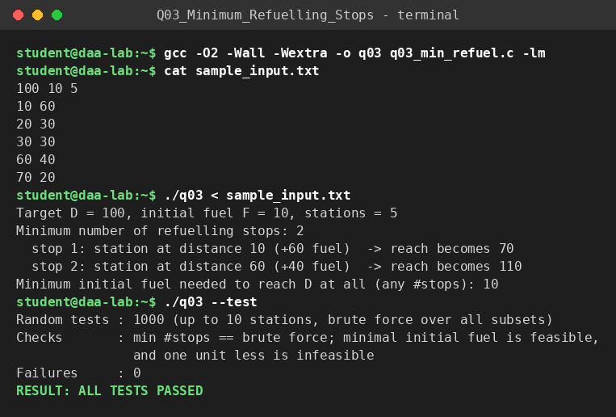

# Q3 – Minimum Refuelling Stops (Reverse / lazy greedy)

**File:** `q03_min_refuel.c`  |  **Paradigm:** greedy with a max-heap

## Problem
A vehicle starts at 0 with fuel `F` (1 unit of fuel = 1 unit of distance) and must reach `D`. Station `i` is at distance `d_i` and supplies `f_i`. Find the minimum number of refuelling stops.

> The title says "Minimum Initial Fuel" but the question text asks for the minimum number of stops. The program answers the question as written and **also** prints the smallest initial fuel for which the target is reachable at all (bonus, see below).

## Input representation
```
D F m
d_1 f_1
...
d_m f_m
```
Stations are stored in an array of `{d, f}` sorted by `d`; the heap stores station indices ordered by `f` (max-heap). `long long` is used throughout.

## Algorithm (reverse / lazy decision)
We never decide to stop in advance. We drive as far as possible and decide *afterwards* which of the stations we passed should have been used:
```
reach = F
while reach < D:
    push every station with d_i <= reach
    if heap empty: impossible
    reach += pop_max()          # we "retroactively" stopped at the best passed station
    stops++
```
**Bonus:** reachability is monotone in `F`, so a binary search over `F ∈ [0, D]` with the greedy as feasibility test returns the minimum initial fuel.

## Correctness
Exchange argument: let `S` be an optimal set of stops and `g` the station the greedy takes when its reach first stalls. Any optimal solution must use some passed station to go further; replacing it by the passed station with the largest fuel gives at least the same reach after every step, so it is never worse. Induction on the number of stops. Validation: 1000 random instances against a brute force over **all subsets of stations**, and the minimal initial fuel is checked to be feasible while one unit less is infeasible.

## Complexity
Sorting `O(m log m)`. Each station is pushed once and popped at most once, each `O(log m)` → `O(m log m)`. **Total `O(m log m)` time, `O(m)` space.** The bonus binary search multiplies by `O(log D)`.

## Build & run
```bash
gcc -O2 -Wall -Wextra -o q03 q03_min_refuel.c
./q03 < sample_input.txt
./q03 --test
```

## Sample run
<!-- SAMPLE_RUN_START -->
```text
$ gcc -O2 -Wall -Wextra -o q03 q03_min_refuel.c -lm
$ cat sample_input.txt
100 10 5
10 60
20 30
30 30
60 40
70 20
$ ./q03 < sample_input.txt
Target D = 100, initial fuel F = 10, stations = 5
Minimum number of refuelling stops: 2
  stop 1: station at distance 10 (+60 fuel)  -> reach becomes 70
  stop 2: station at distance 60 (+40 fuel)  -> reach becomes 110
Minimum initial fuel needed to reach D at all (any #stops): 10
$ ./q03 --test
Random tests : 1000 (up to 10 stations, brute force over all subsets)
Checks       : min #stops == brute force; minimal initial fuel is feasible,
               and one unit less is infeasible
Failures     : 0
RESULT: ALL TESTS PASSED
```


<!-- SAMPLE_RUN_END -->
