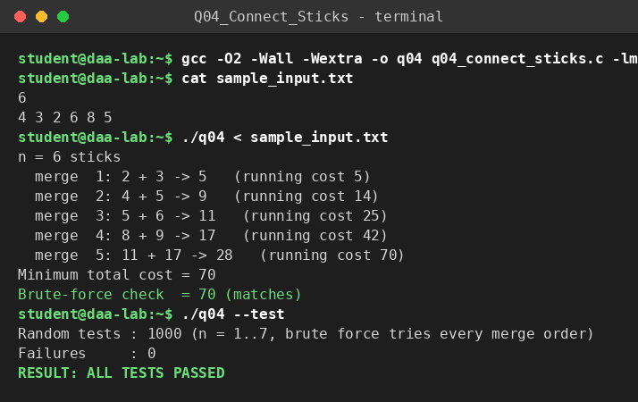

# Q4 – Minimum Cost to Connect Sticks

**File:** `q04_connect_sticks.c`  |  **Paradigm:** greedy (Huffman-style merging)

## Problem
Joining sticks of lengths `x` and `y` costs `x + y` and produces one stick of length `x + y`. Join all `n` sticks into one at minimum total cost.

## Input representation
```
n
L_1 ... L_n
```
A `long long` array turned into an array-based **min-heap**.

## Algorithm
Repeat `n−1` times: remove the two shortest sticks `x, y`, add `x + y` to the cost, push `x + y` back.

## Correctness
The merge process is a binary tree whose leaves are the original sticks. A stick that takes part in `d` merges is paid for `d` times, so the total cost equals `Σ L_i · depth_i` – the weighted external path length that Huffman's algorithm minimises. The two shortest sticks can always be made siblings at the deepest level (exchange argument), and merging them leaves a smaller instance whose cost differs by exactly `x + y`; induction proves optimality. Validation: 1000 random instances against an exhaustive search over all merge orders.

## Complexity
Heap build `O(n)`; `n−1` rounds with 2 delete-mins and 1 insert, each `O(log n)`. **`O(n log n)` time, `O(n)` space.** (If the lengths are sorted first, a two-queue method does the merge phase in `O(n)`.)

## Build & run
```bash
gcc -O2 -Wall -Wextra -o q04 q04_connect_sticks.c
./q04 < sample_input.txt
./q04 --test
```

## Sample run
<!-- SAMPLE_RUN_START -->
```text
$ gcc -O2 -Wall -Wextra -o q04 q04_connect_sticks.c -lm
$ cat sample_input.txt
6
4 3 2 6 8 5
$ ./q04 < sample_input.txt
n = 6 sticks
  merge  1: 2 + 3 -> 5   (running cost 5)
  merge  2: 4 + 5 -> 9   (running cost 14)
  merge  3: 5 + 6 -> 11   (running cost 25)
  merge  4: 8 + 9 -> 17   (running cost 42)
  merge  5: 11 + 17 -> 28   (running cost 70)
Minimum total cost = 70
Brute-force check  = 70 (matches)
$ ./q04 --test
Random tests : 1000 (n = 1..7, brute force tries every merge order)
Failures     : 0
RESULT: ALL TESTS PASSED
```


<!-- SAMPLE_RUN_END -->
