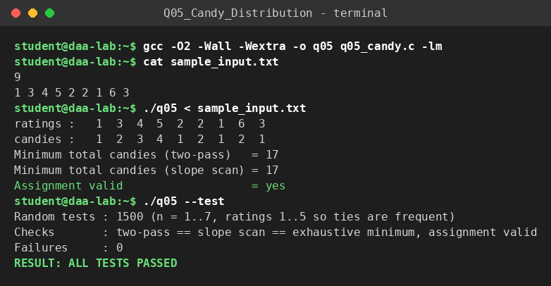

# Q5 – Candy Distribution (bi-directional slope greedy)

**File:** `q05_candy.c`  |  **Paradigm:** greedy, two sweeps / slope counting

## Problem
`n` children stand in a line with ratings `r_i`. Everyone gets ≥ 1 candy; a child with a strictly higher rating than an adjacent child gets strictly more candies than that neighbour. Minimise the total.

## Input representation
```
n
r_1 ... r_n
```
Integer arrays `r[]` (ratings) and `c[]` (candies).

## Algorithm
**Method A – two passes.** Left→right: `c[i] = c[i−1] + 1` if `r[i] > r[i−1]`, else `1`. Right→left: if `r[i] > r[i+1]`, `c[i] = max(c[i], c[i+1] + 1)`.
**Method B – slope scan, O(1) extra space.** Track the lengths of the current ascending run `up`, descending run `down` and the height `peak` of the last peak. Each step adds `1 + up` on ascent, `1` on a plateau (resetting), and `1 + down` on descent, minus one if the descent has not yet exceeded the peak (the peak already holds enough candies); a descent longer than the peak lifts the peak by one.

## Correctness
Pass 1 gives the pointwise-smallest values satisfying all left-neighbour constraints. Pass 2 raises a value only when a right-neighbour constraint forces it, and raising a value never violates a left-neighbour constraint already satisfied (it only makes `c[i]` larger relative to `c[i−1]` where `r[i] > r[i−1]`; where `r[i] < r[i−1]` the left child is the one that was already forced). Each `c[i]` therefore equals the length of the longest strictly-increasing chain ending at `i` in either direction, which every valid assignment must at least reach, so the sum is minimal. Validation: 1500 random inputs with many ties (ratings 1..5), both methods compared with an exhaustive search over all assignments.

## Complexity
Method A: two linear passes → **`O(n)` time, `O(n)` space**. Method B: one pass → **`O(n)` time, `O(1)` extra space**.

## Build & run
```bash
gcc -O2 -Wall -Wextra -o q05 q05_candy.c
./q05 < sample_input.txt
./q05 --test
```

## Sample run
<!-- SAMPLE_RUN_START -->
```text
$ gcc -O2 -Wall -Wextra -o q05 q05_candy.c -lm
$ cat sample_input.txt
9
1 3 4 5 2 2 1 6 3
$ ./q05 < sample_input.txt
ratings :   1  3  4  5  2  2  1  6  3
candies :   1  2  3  4  1  2  1  2  1
Minimum total candies (two-pass)   = 17
Minimum total candies (slope scan) = 17
Assignment valid                   = yes
$ ./q05 --test
Random tests : 1500 (n = 1..7, ratings 1..5 so ties are frequent)
Checks       : two-pass == slope scan == exhaustive minimum, assignment valid
Failures     : 0
RESULT: ALL TESTS PASSED
```


<!-- SAMPLE_RUN_END -->
