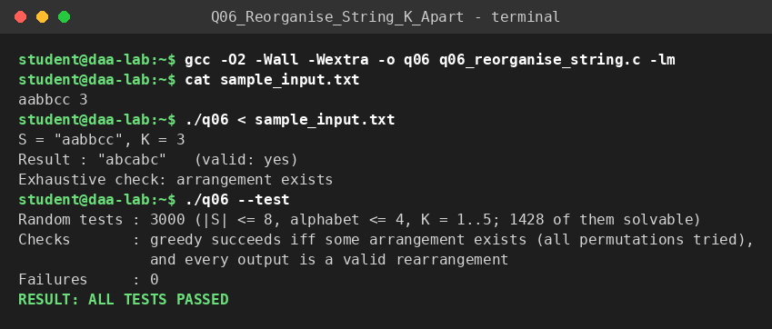

# Q6 – Reorganise String with K-Distance Apart

**File:** `q06_reorganise_string.c`  |  **Paradigm:** greedy with cool-down

## Problem
Rearrange string `S` so that equal characters are at least `K` positions apart (indices of equal characters differ by ≥ `K`). Return the empty string if impossible.

## Input representation
```
S K
```
`S` is a space-free token (up to 100 000 characters). State: `cnt[256]` (copies left) and `last[256]` (position of last use; initially −∞).

## Algorithm
For each position `i = 0 … n−1`: among characters with `cnt > 0` and `i − last[c] ≥ K` (the character has cooled down) choose the one with the **most copies left** (ties: used longest ago, then smallest code). Place it, decrement its count, set `last = i`. If no character is available the answer is "impossible". For `K ≤ 1` there is no restriction and `S` is returned unchanged.

## Correctness
A character with many copies left has the least slack: it needs a slot at least every `K` positions, so deferring it can only turn a feasible schedule infeasible (exchange argument on the first position where an optimal arrangement differs from the greedy). A fully rigorous proof needs a careful case analysis of ties, so the implementation is **validated exhaustively**: 3000 random strings (|S| ≤ 8, up to 4 distinct letters, `K` = 1..5; about half are solvable) are checked against *all permutations*. The greedy must succeed exactly when some valid arrangement exists, and every output must be a valid rearrangement.

## Complexity
Each of the `n` positions scans the `σ = 256` counters: **`O(n·σ)` = `O(n)` time** for a fixed alphabet, `O(σ + n)` space. With a max-heap of available characters and a FIFO cool-down queue the same strategy runs in `O(n log σ)`.

## Build & run
```bash
gcc -O2 -Wall -Wextra -o q06 q06_reorganise_string.c
./q06 < sample_input.txt
./q06 --test
```

## Sample run
<!-- SAMPLE_RUN_START -->
```text
$ gcc -O2 -Wall -Wextra -o q06 q06_reorganise_string.c -lm
$ cat sample_input.txt
aabbcc 3
$ ./q06 < sample_input.txt
S = "aabbcc", K = 3
Result : "abcabc"   (valid: yes)
Exhaustive check: arrangement exists
$ ./q06 --test
Random tests : 3000 (|S| <= 8, alphabet <= 4, K = 1..5; 1428 of them solvable)
Checks       : greedy succeeds iff some arrangement exists (all permutations tried),
               and every output is a valid rearrangement
Failures     : 0
RESULT: ALL TESTS PASSED
```


<!-- SAMPLE_RUN_END -->
