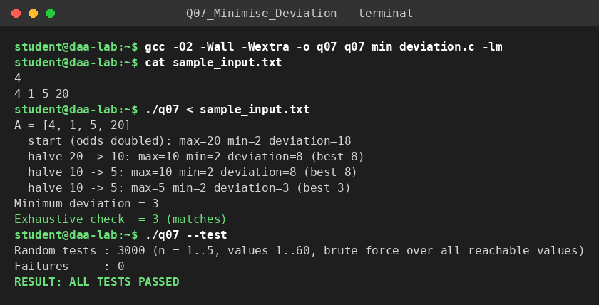

# Q7 – Minimise Deviation in Array (two-way greedy with max-heap)

**File:** `q07_min_deviation.c`  |  **Paradigm:** greedy + max-heap

## Problem
Given positive integers, you may multiply any **odd** element by 2 or divide any **even** element by 2, any number of times. Minimise `max(A) − min(A)`.

## Input representation
```
n
a_1 ... a_n
```
`long long` array; a max-heap of the current values; a variable `mn` holding the current minimum.

## Algorithm
1. **Make the problem one-directional:** double every odd element. An odd `x` can only ever be `x` or `2x`, so after this step every element is at its largest possible value and the only move left is "halve an even element". (The minimum of the final array is tracked, so the option of keeping `x` is not lost – `x` is reached by halving `2x` once.)
2. Push all values into a max-heap, remember the minimum `mn`, and record `best = max − mn`.
3. While the maximum is even: pop it, halve it, push it back, update `mn` and `best`. Stop when the maximum is odd.

## Correctness
Only decreasing the **current maximum** can shrink the deviation; lowering any other element cannot reduce `max − min` and can only lower the minimum. Once the maximum is odd it cannot decrease, so no further improvement is possible. Every element is monotonically non-increasing along the process, and `best` records the best state seen. Validation: 3000 random arrays (n ≤ 5, values ≤ 60) against an exhaustive search over **every reachable value** of every element (`o·2^j` for even values and `{o, 2o}` for odd).

## Complexity
Every element can be halved at most `log₂ M` times (`M` = largest value), so there are `O(n log M)` heap operations of cost `O(log n)`. **`O(n log n · log M)` time, `O(n)` space** (the initial heap build is `O(n)`).

## Build & run
```bash
gcc -O2 -Wall -Wextra -o q07 q07_min_deviation.c
./q07 < sample_input.txt
./q07 --test
```

## Sample run
<!-- SAMPLE_RUN_START -->
```text
$ gcc -O2 -Wall -Wextra -o q07 q07_min_deviation.c -lm
$ cat sample_input.txt
4
4 1 5 20
$ ./q07 < sample_input.txt
A = [4, 1, 5, 20]
  start (odds doubled): max=20 min=2 deviation=18
  halve 20 -> 10: max=10 min=2 deviation=8 (best 8)
  halve 10 -> 5: max=10 min=2 deviation=8 (best 8)
  halve 10 -> 5: max=5 min=2 deviation=3 (best 3)
Minimum deviation = 3
Exhaustive check  = 3 (matches)
$ ./q07 --test
Random tests : 3000 (n = 1..5, values 1..60, brute force over all reachable values)
Failures     : 0
RESULT: ALL TESTS PASSED
```


<!-- SAMPLE_RUN_END -->
