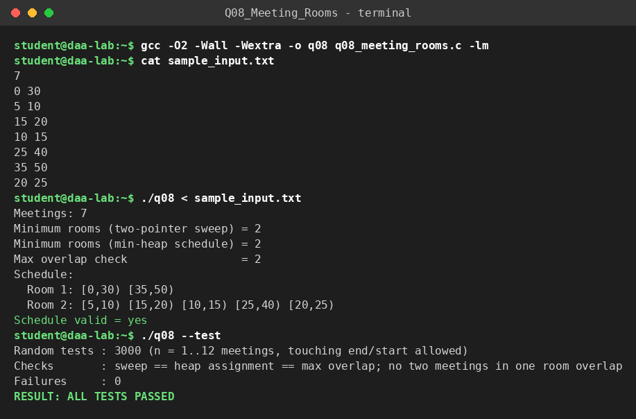

# Q8 – Minimum Number of Meeting Rooms

**File:** `q08_meeting_rooms.c`  |  **Paradigm:** greedy sweep / interval partitioning

## Problem
Given meeting intervals `[s_i, e_i)`, find the minimum number of rooms. A meeting that ends at time `t` and one that starts at `t` may share a room (half-open intervals).

## Input representation
```
n
s_1 e_1
...
s_n e_n
```
Array of `{s, e, id}`. Method A uses two independently sorted integer arrays (starts and ends); Method B uses a min-heap of `{end, room}` pairs.

## Algorithm
**Method A – two-pointer sweep.** Sort starts and ends separately. Walk through them: if the next start is before the next end, a new meeting begins (`rooms++`), otherwise a meeting ends (`rooms−−`). The answer is the maximum value reached.
**Method B – explicit schedule.** Sort meetings by start time. Keep a min-heap keyed by end time. If the room that frees up earliest is already free (`end ≤ s`), reuse it; otherwise open a new room.

## Correctness
Lower bound: if `k` meetings are active at the same instant they need `k` different rooms, so rooms ≥ maximum overlap. Upper bound: processing by start time, a new room is opened only when *all* existing rooms are busy at that start, i.e. at least `rooms` meetings are simultaneously active, so rooms ≤ maximum overlap. Hence both are equal and greedy is optimal. Validation: 3000 random instances; the sweep, the heap schedule and a direct maximum-overlap count must agree, and the produced schedule is checked so that no two meetings in the same room overlap.

## Complexity
Sorting `O(n log n)`; sweep `O(n)`; heap method: `n` insertions/removals of `O(log n)`. **`O(n log n)` time, `O(n)` space.**

## Build & run
```bash
gcc -O2 -Wall -Wextra -o q08 q08_meeting_rooms.c
./q08 < sample_input.txt
./q08 --test
```

## Sample run
<!-- SAMPLE_RUN_START -->
```text
$ gcc -O2 -Wall -Wextra -o q08 q08_meeting_rooms.c -lm
$ cat sample_input.txt
7
0 30
5 10
15 20
10 15
25 40
35 50
20 25
$ ./q08 < sample_input.txt
Meetings: 7
Minimum rooms (two-pointer sweep) = 2
Minimum rooms (min-heap schedule) = 2
Max overlap check                 = 2
Schedule:
  Room 1: [0,30) [35,50)
  Room 2: [5,10) [15,20) [10,15) [25,40) [20,25)
Schedule valid = yes
$ ./q08 --test
Random tests : 3000 (n = 1..12 meetings, touching end/start allowed)
Checks       : sweep == heap assignment == max overlap; no two meetings in one room overlap
Failures     : 0
RESULT: ALL TESTS PASSED
```


<!-- SAMPLE_RUN_END -->
