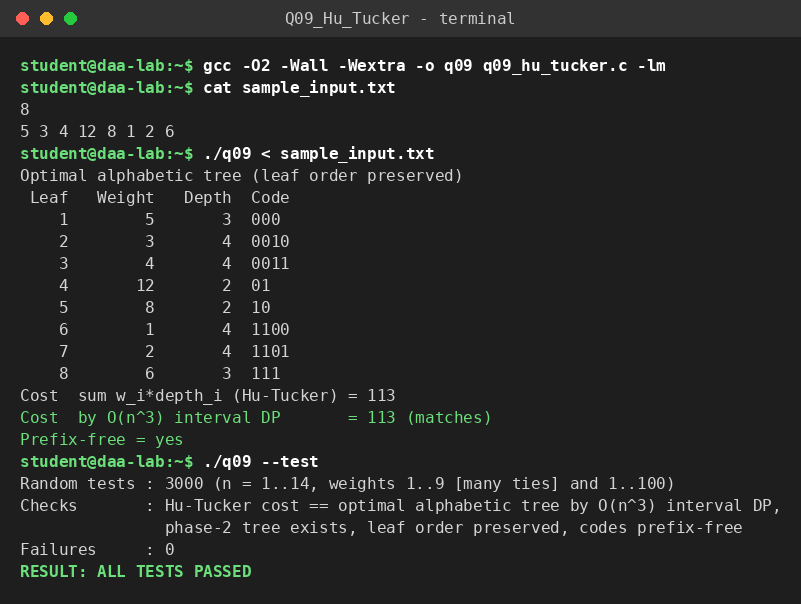

# Q9 – Hu–Tucker Greedy Simulation (optimal alphabetic tree)

**File:** `q09_hu_tucker.c`  |  **Paradigm:** greedy (two-phase algorithm)

## Problem
Given weights `w_1 … w_n` in a fixed order, build a binary tree whose leaves appear in the same left-to-right order and which minimises `Σ w_i · depth(i)` (an optimal alphabetic code / optimal merge pattern that respects the order).

## Input representation
```
n
w_1 ... w_n
```
A sequence of "current nodes", each stored as `{weight, is_square, node_id}` in parallel arrays. Original leaves are *square* (terminal); merged nodes are *circle*. A `leafNode[]` array records which current node each leaf lies under, so depths can be incremented on every merge.

## Algorithm
**Phase 1 – combination.**
1. Two nodes are *compatible* if no square node lies strictly between them.
2. Repeatedly choose the compatible pair with the **smallest weight sum** (ties: leftmost first node, then leftmost second node), replace it by one circle node of the summed weight at the position of the left node, and add 1 to the depth of every leaf below it.
3. After `n−1` merges we know the depth of every leaf. These depths are generally *not* those of an alphabetic tree built directly by the merges.

**Phase 2 – recombination.** Scan the leaves left to right with a stack of `(node, depth)`; whenever the top two entries have equal depth, merge them into one entry of depth − 1. Hu–Tucker's theorem guarantees this ends with a single node of depth 0, giving a tree with the *same leaf depths* in the original order. Codes follow by labelling left/right edges `0/1`.

## Correctness
Optimality of the Hu–Tucker algorithm is a classical theorem (Hu & Tucker, 1971); the program does not re-prove it, it **checks it empirically**: 3000 random inputs (n ≤ 14; weights in 1..9 so ties are frequent, and in 1..100) compare the Hu–Tucker cost with the exact optimum from the interval DP `C[i][j] = W(i..j) + min_k (C[i][k] + C[k+1][j])`, and verify that phase 2 always succeeds and the codes are prefix-free. The tie-breaking rule above matters for the leaf depths, and this test is what confirms it.

## Complexity
* Phase 1: `n−1` rounds. In a round every `i` scans partners until the first square node, which is `O(n²)` pairs in the worst case, plus `O(n)` to update depths → `O(n³)` worst case for this simple simulation (usually much less because the scan stops at squares).
* Phase 2: `O(n)`. Code assignment `O(n · depth)`.
* Validation DP: `O(n³)` time, `O(n²)` space.
* With priority queues / mergeable structures Hu–Tucker can be implemented in `O(n log n)` (Hu–Tucker 1971 / Garsia–Wachs); this lab version trades speed for clarity.

## Build & run
```bash
gcc -O2 -Wall -Wextra -o q09 q09_hu_tucker.c
./q09 < sample_input.txt
./q09 --test
```

## Sample run
<!-- SAMPLE_RUN_START -->
```text
$ gcc -O2 -Wall -Wextra -o q09 q09_hu_tucker.c -lm
$ cat sample_input.txt
8
5 3 4 12 8 1 2 6
$ ./q09 < sample_input.txt
Optimal alphabetic tree (leaf order preserved)
 Leaf   Weight   Depth  Code
    1        5       3  000
    2        3       4  0010
    3        4       4  0011
    4       12       2  01
    5        8       2  10
    6        1       4  1100
    7        2       4  1101
    8        6       3  111
Cost  sum w_i*depth_i (Hu-Tucker) = 113
Cost  by O(n^3) interval DP       = 113 (matches)
Prefix-free = yes
$ ./q09 --test
Random tests : 3000 (n = 1..14, weights 1..9 [many ties] and 1..100)
Checks       : Hu-Tucker cost == optimal alphabetic tree by O(n^3) interval DP,
               phase-2 tree exists, leaf order preserved, codes prefix-free
Failures     : 0
RESULT: ALL TESTS PASSED
```


<!-- SAMPLE_RUN_END -->
