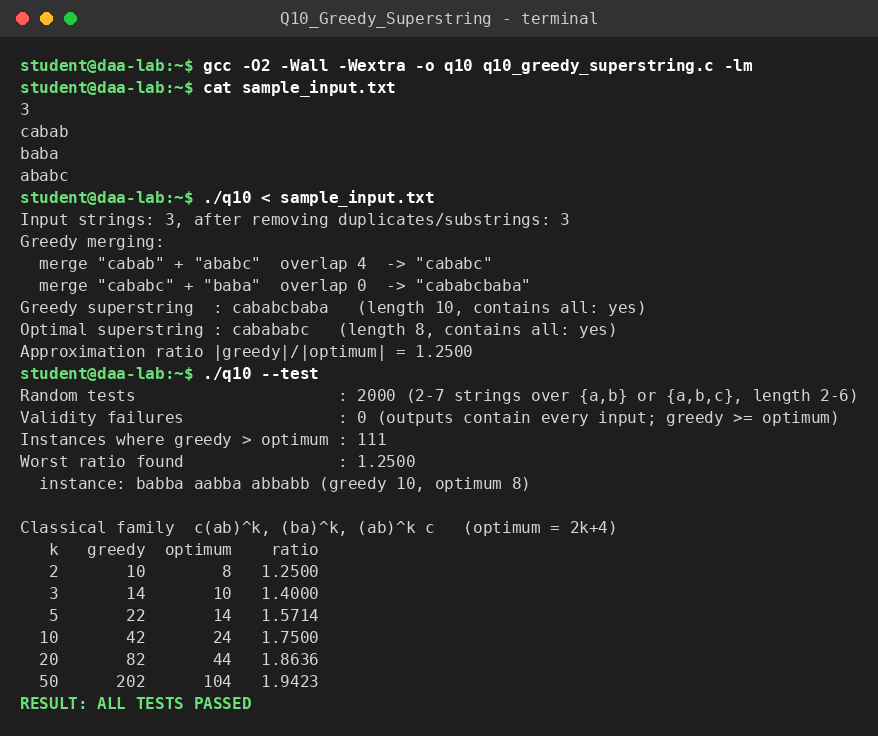

# Q10 – Greedy Superstring Conjecture (open problem)

**File:** `q10_greedy_superstring.c`  |  **Paradigm:** greedy approximation vs exact search

## Problem
Given strings `S = {s_1, …, s_n}`, find the shortest string that contains every `s_i` as a substring (Shortest Common Superstring, NP-hard). The **Greedy Superstring Conjecture** states that the greedy algorithm (repeatedly merge the ordered pair with the largest suffix/prefix overlap) returns a string of length at most `2·OPT`.

## Status of the conjecture (as of 7 Oct 2026)
* The lab sheet mentions a September 2026 arXiv paper, *Disproving the Greedy Superstring Conjecture*. It does exist: arXiv:2609.01365, by Hiroki Shibata, submitted 2 Sept 2026 (version 1).
* Its claim: for every even `k ≥ 10` there are instances with all strings of length `k` where the greedy ratio is at least `(9k+2)/(4k+4)` (≈ 2.09 at `k = 10`, tending to `9/4`). The paper states that the counterexample and proof strategy were first found by an AI model and then examined and simplified by the author.
* I could find no indication of peer review or independent verification: it is a preprint. Treat it as a **claim not yet confirmed**, which agrees with the caveat in your lab sheet. This program does **not** reproduce or check that construction (it needs strings of length ≥ 10 built in a specific way that I did not have); it is a workbench for exploring the problem at small sizes.

Source: [arXiv:2609.01365](https://arxiv.org/abs/2609.01365)

## Input representation
```
n
s_1 ... s_n
```
Strings are heap-allocated C strings. First, duplicates and strings that are substrings of other strings are removed (they never change the answer). The overlap matrix `ov[i][j]` stores the longest suffix of `s_i` that is a prefix of `s_j`.

## What the program does
1. **Greedy:** pick the pair with maximum `ov`, merge (`s_i + s_j[ov..]`), recompute only the row and column of the merged string, repeat until one string is left.
2. **Exact optimum (n ≤ 15 after reduction):** bitmask DP `dp[mask][last]` = length of the shortest superstring of the strings in `mask` ending with `last`; transition `dp[mask ∪ {j}][j] = dp[mask][i] + |s_j| − ov[i][j]`. This is valid because, for a substring-free set, an optimal superstring is a permutation merged by maximum overlaps.
3. **`--test` experiments:** random small instances (where does greedy lose, and by how much?) and the classical family `c(ab)^k, (ba)^k, (ab)^k c` whose optimum is `2k+4` while greedy gives `4k+2`, so the ratio climbs towards 2 – this shows why 2 was the natural conjectured bound. The largest ratio from random search at these tiny sizes is only 1.25.

## Ideas for exploring further
* Run `./q10` on your own inputs, e.g. strings of one fixed even length `k ≥ 10` over `{a, b}`, and look at the ratio `|greedy| / |OPT|` (keep `n ≤ 15` so the exact DP applies).
* Replace the random generator by hill-climbing: mutate an instance and keep it if the ratio increases. The paper's strings of length ≥ 10 show why random search at small sizes does not get near 2.09.
* Compare tie-breaking rules; the known result that all greedy instantiations are equivalent in approximation ratio is a good thing to read up on.

## Complexity
(`N` = total length, `L` = longest string, `n` strings)
* Overlap of two strings: `O(L²)` with the naive scan used here.
* Greedy: initial matrix `O(n²L²)`; each of the `n−1` merges rescans `O(n²)` entries and recomputes `2n` overlaps on strings of length up to `N`, so `O(n³ + n²N²)` worst case for this simple implementation. Linear-time implementations of greedy exist (suffix structures / Aho–Corasick); this one favours clarity.
* Exact DP: `O(2ⁿ · n²)` time, `O(2ⁿ · n)` space.

## Build & run
```bash
gcc -O2 -Wall -Wextra -o q10 q10_greedy_superstring.c
./q10 < sample_input.txt
./q10 --test
```

## Sample run
<!-- SAMPLE_RUN_START -->
```text
$ gcc -O2 -Wall -Wextra -o q10 q10_greedy_superstring.c -lm
$ cat sample_input.txt
3
cabab
baba
ababc
$ ./q10 < sample_input.txt
Input strings: 3, after removing duplicates/substrings: 3
Greedy merging:
  merge "cabab" + "ababc"  overlap 4  -> "cababc"
  merge "cababc" + "baba"  overlap 0  -> "cababcbaba"
Greedy superstring  : cababcbaba   (length 10, contains all: yes)
Optimal superstring : cabababc   (length 8, contains all: yes)
Approximation ratio |greedy|/|optimum| = 1.2500
$ ./q10 --test
Random tests                     : 2000 (2-7 strings over {a,b} or {a,b,c}, length 2-6)
Validity failures                : 0 (outputs contain every input; greedy >= optimum)
Instances where greedy > optimum : 111
Worst ratio found                : 1.2500
  instance: babba aabba abbabb (greedy 10, optimum 8)

Classical family  c(ab)^k, (ba)^k, (ab)^k c   (optimum = 2k+4)
   k   greedy  optimum    ratio
   2       10        8   1.2500
   3       14       10   1.4000
   5       22       14   1.5714
  10       42       24   1.7500
  20       82       44   1.8636
  50      202      104   1.9423
RESULT: ALL TESTS PASSED
```


<!-- SAMPLE_RUN_END -->
